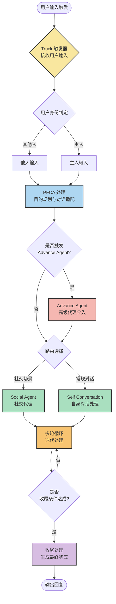

# Abyss Core 架构图

## 1. 消息处理主流程（对话路由）

## 2. 说明

- **Truck 触发器**：系统入口，负责接收并路由用户输入
- **用户身份区分**：他人 / 主人，走同一处理管线但上下文与权限不同
- **PFCA**：所有输入必经的统一处理层（目的规划 / 上下文适配）
- **Advance Agent**：可选介入的高级代理，用于复杂决策
- **Social Agent vs Self Conversation**：二选一的响应生成路径
- **多轮循环**：对话迭代，直到满足收尾条件

---

> 后续将补充：注意力模块、记忆模块、API 层的关联图。
